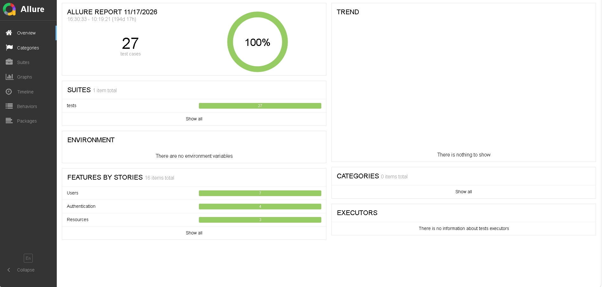

# Reqres API Tests

## Что тестирует проект

Тесты проверяют работу API сервиса [Reqres.in](https://reqres.in). Проверяются операции с пользователями и ресурсами:
- Получение списка пользователей и одного пользователя по ID
- Создание пользователя
- Обновление пользователя (PUT и PATCH)
- Удаление пользователя
- Авторизация (логин и регистрация)
- Получение ресурсов

## Технологии

- Python 3.11+
- Pytest
- Allure (отчетность)
- Pydantic (валидация моделей)
- Requests (HTTP-клиент)
- Faker (генерация тестовых данных)
- Docker

## Установка и запуск

```bash
# Клонировать репозиторий
git clone https://github.com/Ruslan711/reqres-api-tests.git
cd reqres-api-tests

# Создать виртуальное окружение
python -m venv venv
source venv/bin/activate  # на Windows: venv\Scripts\activate

# Установить зависимости
pip install -r requirements.txt

# Скопировать .env.example в .env и заполнить переменные окружения
cp .env.example .env
```

## Запуск тестов

```bash
# Запуск всех тестов
pytest

# Запуск на определенном окружении
pytest --env=dev
pytest --env=stage

# Запуск с маркерами
pytest -m smoke
pytest -m regression
```

## Allure-отчёт

```bash
# Открыть отчёт в браузере
allure serve allure-results

# Сгенерировать отчёт в папку
allure generate allure-results -o allure-report --clean
```



## Запуск в Docker

Docker Desktop должен быть запущен.

```bash
docker compose up --build
```

Отчёт сохраняется в папку `allure-results`.
